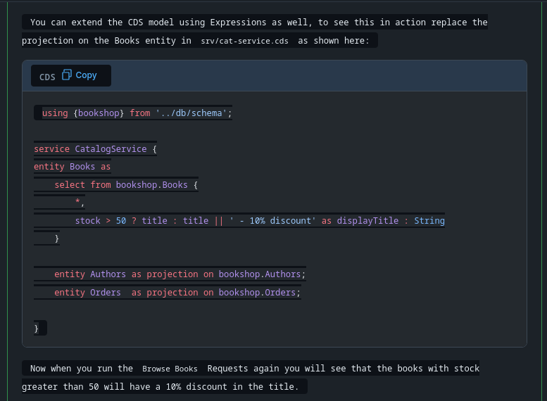
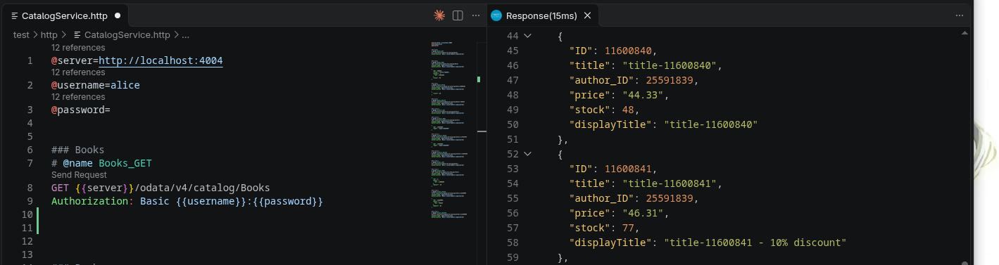
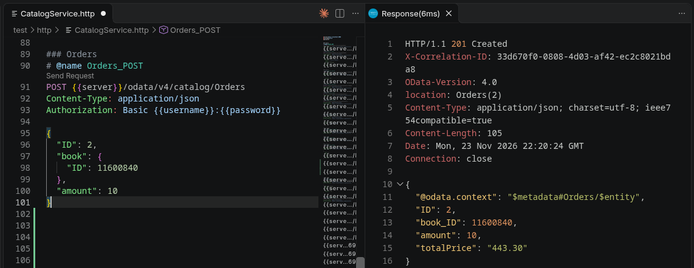
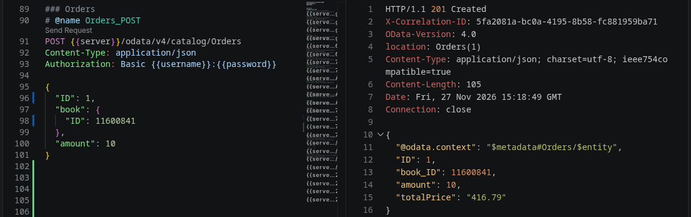
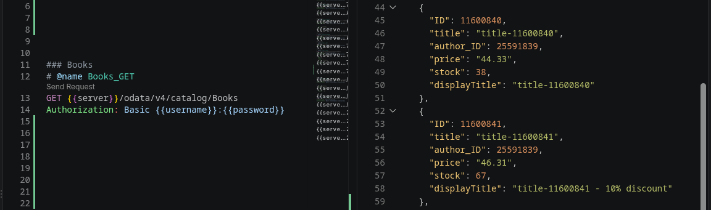

# Buchshop-Service mit SAP CAP

Ein Tutorial-Projekt, mit dem ich in die SAP-Entwicklung eingestiegen bin: ein kleiner Buchshop-Service, gebaut mit dem SAP Cloud Application Programming Model (CAP) und Node.js.

Grundlage ist das offizielle SAP-Tutorial „Create a CAP Business Service with Node.js Using Visual Studio Code" von developers.sap.com. Danach habe ich noch eine eigene Preis- und Rabattlogik eingebaut.

Der Service verwaltet Bücher, Autoren und Bestellungen. Bei jeder Bestellung sinkt der Lagerbestand, und der Gesamtbetrag wird automatisch berechnet. Bei hohem Lagerbestand gibt es 10 % Rabatt.

## Verwendete Technologien

- **SAP CAP** (cds 10): SAPs Backend-Framework, das aus dem Datenmodell automatisch einen OData-Service erzeugt
- **Node.js** mit ES-Modulen
- **SQLite** als lokale Datenbank
- **VS Code** mit SAP CDS Language Support und REST Client für Testanfragen

## Grundgerüst aus dem Tutorial

- Datenmodell mit den Entitäten Books, Authors und Orders (`db/schema.cds`)
- CatalogService, der die Daten als OData-Service bereitstellt (`srv/cat-service.cds`)
- Generierte Testdaten im CSV-Format (`db/data/`)
- HTTP-Testanfragen für den REST Client (`test/http/CatalogService.http`)
- Handler, der bei jeder Bestellung den Lagerbestand senkt (`srv/cat-service.js`)
- Berechnetes Feld `displayTitle`, das rabattierte Bücher im Titel kennzeichnet

## Eigene Erweiterung

### Widerspruch im Tutorial beim Rabatt

Im Tutorial widersprechen sich Text und Code. Der Code hängt den Rabatt-Zusatz an Bücher mit 50 Stück oder weniger. Im Text steht aber „greater than 50", also ab einem hohen Bestand. Das ergibt für mich auch kaufmännisch mehr Sinn. Ich habe mich deshalb an den Text gehalten und im Code nur das Größer-Zeichen in ein Kleiner-Zeichen geändert. Dadurch bekommt bei mir schon ein Buch mit genau 50 Stück den Rabatt.



Meine Version in der srv/cat-service.cds:

```cds
stock < 50 ? title : title || ' - 10% discount'
```

### Rabatt auf den Preis anwenden

Das Tutorial endet mit einer optionalen Aufgabe: den Rabatt tatsächlich auf den Preis anwenden. Dafür habe ich:

- jedem Buch einen Preis gegeben
- jeder Bestellung einen Gesamtbetrag gegeben, der beim Anlegen berechnet und gespeichert wird. Wie bei einem Kassenbon ändert er sich auch bei späteren Preisänderungen nicht mehr
- 10 % Rabatt eingebaut, wenn zum Zeitpunkt der Bestellung mindestens 50 Stück auf Lager sind

Der Rabatt hängt vom Bestand **vor** dem Abzug ab! Deshalb berechnet ein `before`-Handler den Gesamtbetrag, bevor die Bestellung gespeichert wird. Der Bestandsabzug läuft danach im `after`-Handler.

```js
this.before("CREATE", Orders, async (req) => {
  let { amount, book_ID } = req.data;
  const { price, stock } = await SELECT.one.from(Books, book_ID);
  let totalPrice = price * amount;
  if (stock >= 50) totalPrice = totalPrice * 0.9;
  req.data.totalPrice = Math.round(totalPrice * 100) / 100;
});
```

### Ergebnis



Buch 11600841 hat 77 Stück auf Lager und bekommt den Rabatt-Zusatz, Buch 11600840 mit 48 Stück nicht.



10 Stück von Buch 11600840 zu je 44,33 € ergeben 443,30 €. Es gibt keinen Rabatt, weil nur 48 Stück auf Lager sind.



10 Stück von Buch 11600841 zu je 46,31 € ergeben mit 10 % Rabatt 416,79 €.



Nach den beiden Bestellungen über je 10 Stück sinken die Bestände von 77 auf 67 und von 48 auf 38.

## Was ich gelernt habe

Mit dem Operator aus dem Tutorial, `{'-': amount}`, stand plötzlich `{"-":85}` als Text in der Datenbank statt einer Zahl. Richtig ist `{'-=': amount}`.

Außerdem lief der Tutorial-Code mit `require` beim Testen nicht. Durch Recherche habe ich herausgefunden, dass neue Projekte ab cds 10 ES-Module nutzen, in denen `require` nicht mehr funktioniert. Deshalb habe ich auf `import` und `export` umgestellt.

Beim Rabatt habe ich gemerkt, dass es wichtig ist, ob ein Handler vor oder nach dem Speichern läuft. Der Rabatt muss im `before`-Handler geprüft werden, sonst rechnet er schon mit dem gesenkten Bestand.

Den Gesamtbetrag speichere ich in der Bestellung und nicht beim Buch.

## Was noch fehlt

Zwei Sachen fehlen noch. Der `before`-Handler prüft nicht, ob das bestellte Buch überhaupt existiert. Bei einer falschen Buch-ID kommt deshalb ein interner Fehler (HTTP 500) statt einer verständlichen Meldung.

Außerdem wird nicht geprüft, ob genug auf Lager ist. Bei einer großen Bestellung kann der Bestand dadurch ins Minus gehen.
